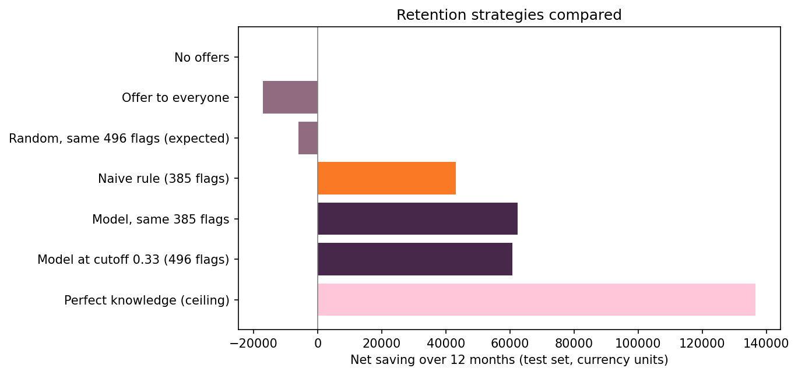
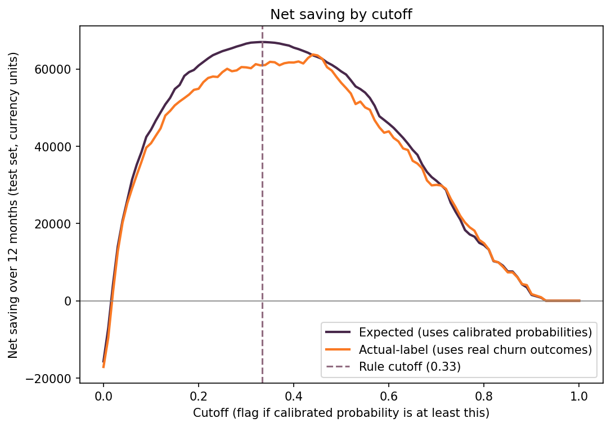
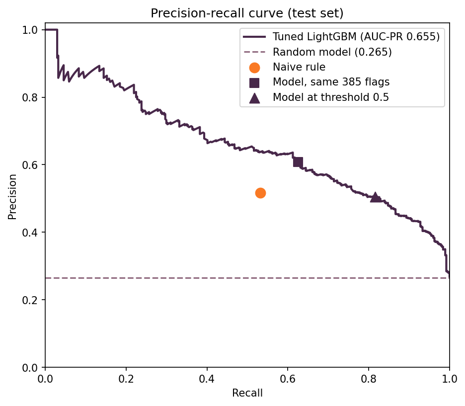
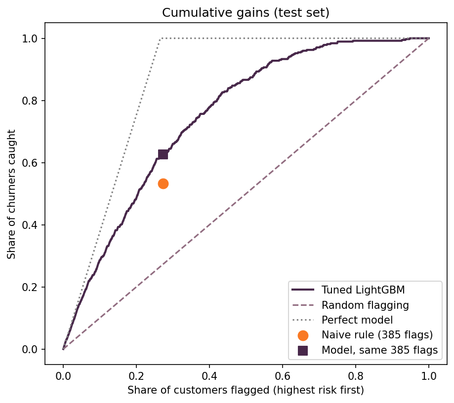
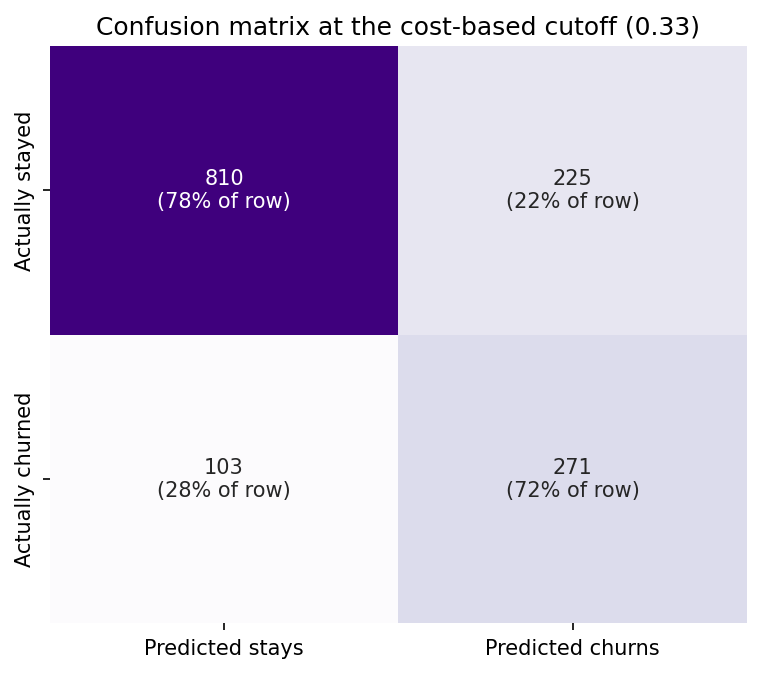
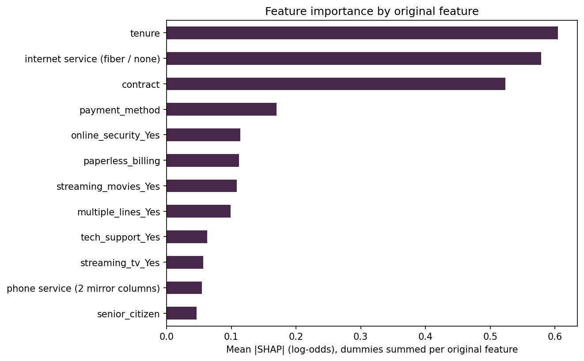

# Telecom Customer Churn: From Prediction to a Profitable Retention Decision

Predicting who will churn is only half the problem. The business question is: **if we offer a discount to the customers the model flags, do we make or lose money?** This project builds a calibrated churn model, derives a cost-based decision cutoff, and tests the resulting campaign against simple alternatives using real held-out outcomes.

> **Status:** analysis and model complete. A live demo (FastAPI service + Streamlit dashboard on Google Cloud Run, Neon Postgres backend) is in progress. See the [roadmap](#roadmap).

## Key results

Dataset: IBM Telco Customer Churn, 7,043 customers, 26.5% churn. Split 80/20 (5,634 train, 1,409 test), stratified, and frozen in `data/split_assignment.csv`. All numbers below are on the **1,409 held-out test customers**.

| Metric | Value |
|---|---|
| AUC-PR (primary metric, imbalanced data) | 0.655 |
| ROC-AUC | 0.842 |
| Brier score, raw model → calibrated | 0.166 → 0.137 |
| Cost-based cutoff | 0.333 |
| Customers flagged at that cutoff | 496 of 1,409 (35%) |
| Recall / precision at that cutoff | 72.5% / 54.6% |
| 12-month net saving vs making no offers | **60,674** \$ (about 43,100 \$ per 1,000 customers) |

### Does targeting beat the alternatives?

Same assumptions for every strategy (offer success rate r = 0.5, discount d = 20%, 12 months), scored with real churn outcomes:

| Strategy | Net saving |
|---|---|
| Offer to everyone | −17,132 |
| Random flagging, same number of flags | −6,031 |
| Naive rule (month-to-month and tenure under 12 months) | 43,079 |
| **Model at the cost-based cutoff** | **60,674** |
| Perfect knowledge (ceiling) | 136,633 |

- The model earns about **41% more than the naive rule**. A paired bootstrap (2,000 resamples of the test customers) puts the gain at **17,661, 95% interval 8,676 to 27,360**, entirely above zero. At the same 385 flags as the naive rule the gain is about 19,400, so the advantage comes from choosing better customers, not from flagging more.
- Blanket offers lose money because the overall churn rate (26.5%) is below the break-even probability (about 33%).
- The campaign stays profitable as long as the offer success rate is above about **0.20** (break-even r = 0.203), so there is a wide margin if offers work worse than assumed.

## Approach

1. **SQL analytics:** the CSV is loaded into a normalised PostgreSQL schema (customers, services, billing, churn status) and five business questions are answered in SQL.
2. **EDA and feature engineering:** cleaning, encoding, a stratified split before any resampling or tuning to avoid leakage.
3. **Model selection:** four model families compared under two ways of handling class imbalance (SMOTENC oversampling vs class weights) with 5-fold cross-validation, scored on AUC-PR. Logistic regression and LightGBM with class weights were taken forward and tuned with Optuna.
4. **Calibration:** class weights improve ranking but inflate probabilities (mean predicted probability 0.417 vs a true churn rate of 26.5%). Sigmoid (Platt) calibration was chosen over isotonic by Brier score, so the probabilities can be used in money calculations.
5. **Decision cutoff:** a customer is worth an offer when `p × r × (1 − d) > (1 − p) × d`, which gives `p* = d / (d + r(1 − d))`. With r = 0.5 and d = 0.2 this is 0.333. A cutoff sweep on the test set checks the rule rather than choosing the cutoff: the saving stays within about 5% of its maximum between 0.3 and 0.45.
6. **Honest evaluation:** like-for-like comparison at equal flag counts, bootstrap intervals, and a sensitivity analysis over the offer success rate.
7. **Explainability:** SHAP importance (grouped by feature family) and a learning curve.

## Plots

| | |
|---|---|
|  |  |
|  |  |
|  |  |

## Limitations

- **The offer success rate r is an assumption.** The dataset has no offers, so r cannot be measured. In practice it would come from an A/B test, and the measured value would replace the assumption. The model predicts who is likely to churn, not who would respond to an offer.
- Savings are for the 1,409 test customers (about 20% of the base), in currency units, and ignore contact costs. Every false alarm is assumed to take the discount.
- The bootstrap interval covers test-sample noise only, not uncertainty in r, d or the 12-month horizon.
- The data is a single snapshot with no dates, so there is no time trend and no check for drift over time.
- A class-weighted logistic regression scored about the same as untuned LightGBM in cross-validation (AUC-PR 0.657 vs 0.640), so the signal in this dataset is largely additive.

## Repository layout

```
notebooks/   01 SQL business questions, 02 EDA, 03 feature engineering, 04 modelling and evaluation
sql/         database schema and creation scripts
db/          loader that fills the PostgreSQL tables from the CSV
models/      calibrated model, raw model, encoder, config, reference statistics
reports/     exported metrics, curves, test predictions and scores for every customer
outputs/     plots and SHAP importance
data/        raw CSV (not tracked) and the frozen train/test split
```

## Reproducing the analysis

1. Download the Telco Customer Churn CSV and place it in `data/Telco-Customer-Churn.csv`.
2. Create a Python 3.11 environment and run `pip install -r requirements-dev.txt`.
3. Copy `.env.example` to `.env`, create the database with `sql/create_db.sql` and `sql/schema.sql`, then run `db/load_data.py`.
4. Run the notebooks in order (01 to 04).

## Roadmap

- [x] SQL analytics, EDA, feature engineering, model selection, calibration, cost-based cutoff, strategy comparison
- [x] Frozen train/test split, exported reports, out-of-fold scores for every customer
- [ ] `churn_core` package with tests (prediction, economics, data-health checks)
- [ ] FastAPI prediction service
- [ ] Streamlit dashboard: single-customer predictor, retention simulator, model performance, business overview, risk explorer
- [ ] Docker, deployment on Google Cloud Run, CI with GitHub Actions
- [ ] Model card

## Author

Nitesh Yadav | [LinkedIn](http://www.linkedin.com/in/nitesh-yadav-48567b217) | [GitHub](https://github.com/Nitesh-Yadavv)